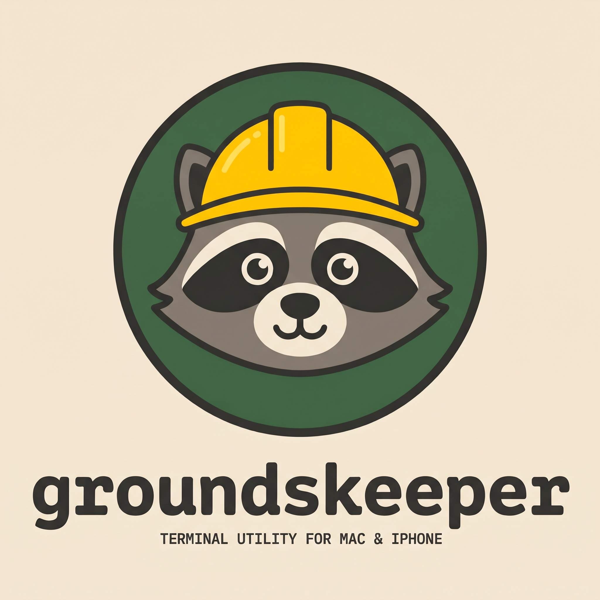

<p align="center">
  
</p>

<p align="center">Keep your Mac's disk, and a connected iPhone, free of clutter.</p>

> **Status:** early development. `scan` reports caches and build artifacts today. See the [implementation plan](docs/groundskeeper-plan.md) for what's next.

Groundskeeper (`groundskeeper`, alias `gk`) is a Lot86 terminal tool for macOS. Twice a week it scans for space you can reclaim and writes an HTML report. It looks for:

- caches
- AI models (Ollama, Hugging Face, LM Studio)
- stale build artifacts
- toolchains
- containers
- old downloads
- browser caches
- unused apps

With an iPhone plugged in over USB, it also reports on the phone's apps, shared files and duplicate photos.

## How it stays safe

- **Scans are read-only.** The report only suggests commands. Nothing is deleted unless you run a `clean` command.
- **`clean` is a dry run unless you add `--apply`.** Browser caches go to the Trash, photos go to Recently Deleted, and site data, cookies and passwords are never touched.
- **Nothing leaves your Mac.** It makes no network requests, measures file sizes without reading contents, and keeps its reports and logs private to your user.

## Commands (planned)

| Group                            | Commands                                               |
| -------------------------------- | ------------------------------------------------------ |
| Report (read-only)               | `scan` (default), `iphone`, `history`, `stats`, `logs` |
| Review                           | `review photos`                                        |
| Clean (dry run unless `--apply`) | `clean browsers`, `clean iphone-apps`, `clean photos`  |
| Setup                            | `setup photos`, `config`, `doctor`                     |

```sh
make build                        # bin/groundskeeper
make test                         # go test ./... and govulncheck
make run                          # scan and open the report
./bin/groundskeeper scan --dry    # summary only, writes nothing
```

## Docs

- [Implementation plan](docs/groundskeeper-plan.md): architecture, scanners, security, logging and build order
- [Rook design brief](docs/rook-design-brief.md): the mascot, palette and voice
