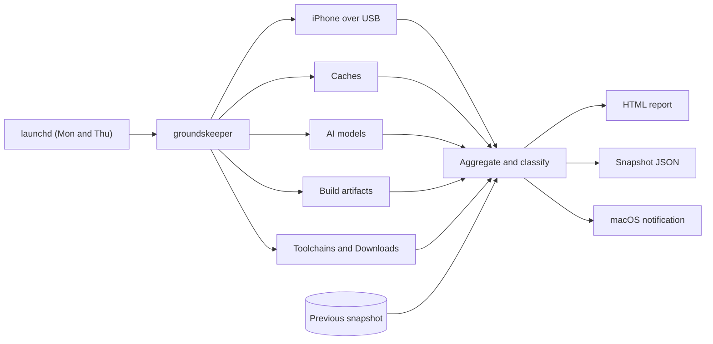
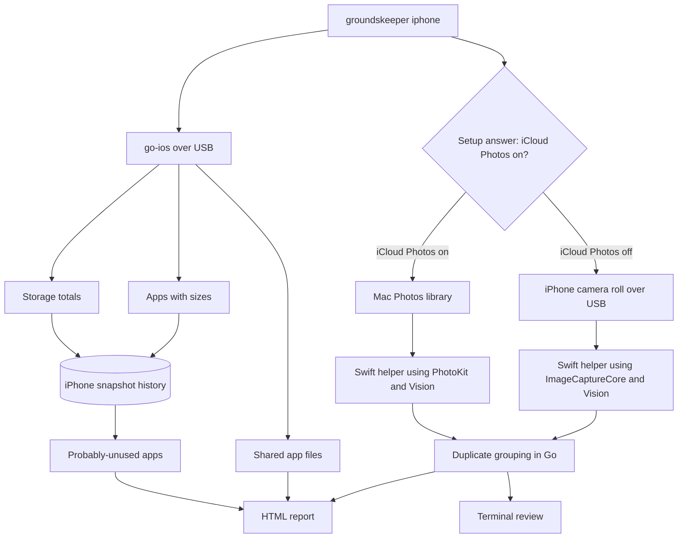
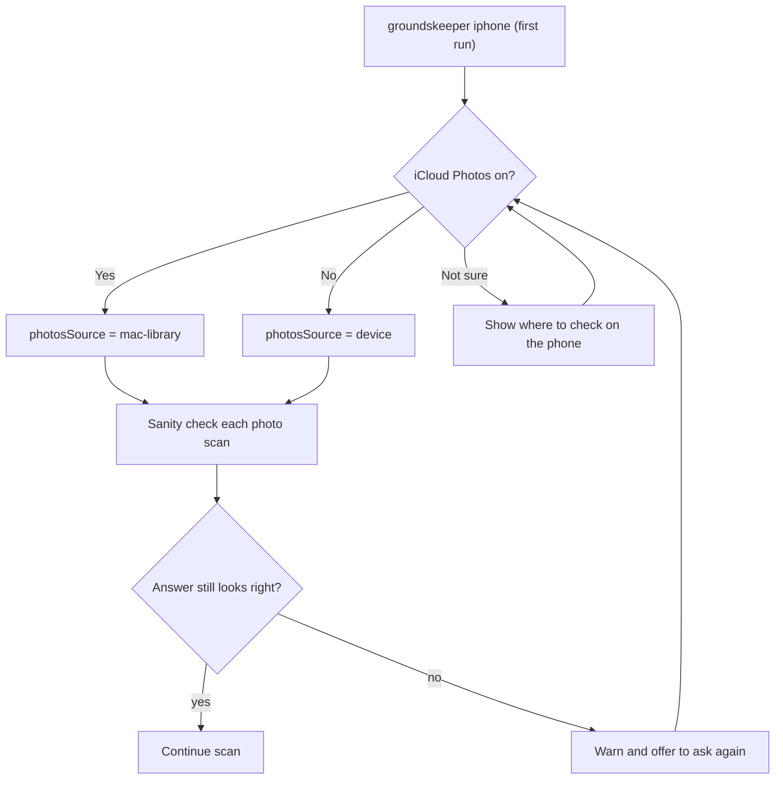
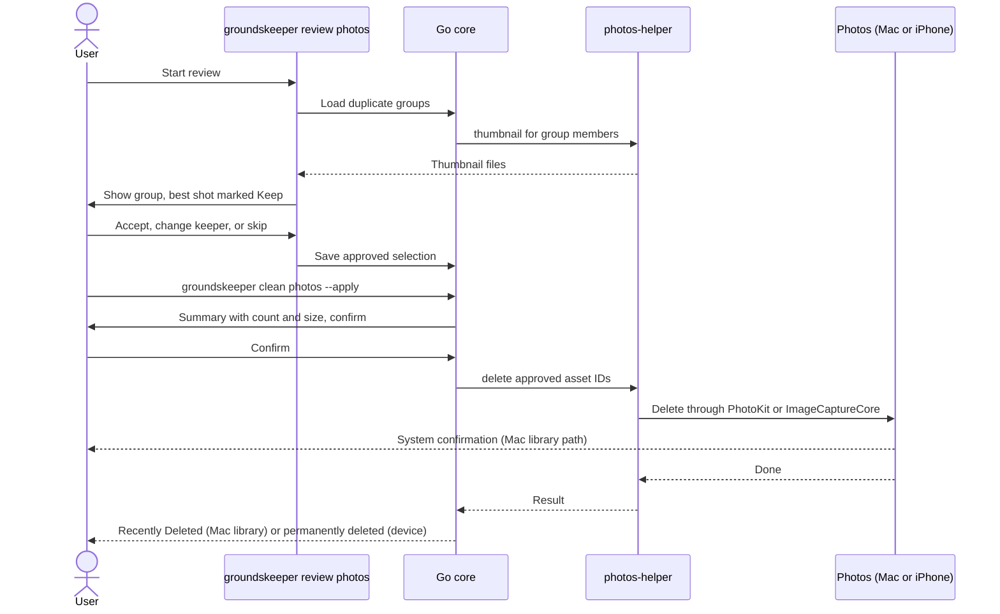

# Groundskeeper — Implementation Plan

**Groundskeeper** is a terminal tool for keeping a Mac's disk free of clutter. The command is `groundskeeper`, with a short alias `gk`.

It runs twice a week on macOS and generates an HTML report of disk space that can be reclaimed: caches, AI models, stale build artifacts, toolchains, and old downloads. With an iPhone plugged in over USB, it also reports and cleans up the phone's apps, shared files and duplicate photos. This replaces the separate iPhone app idea.

## Goals

- **The scan is read-only.** The scheduled report never deletes anything; it only suggests cleanup commands. Cleanup happens only through explicit `clean` subcommands that you run yourself: browser caches (see [Browser cleanup](#browser-cleanup-opt-in)), iPhone apps and duplicate photos (see [iPhone mode](#iphone-mode)).
- **One Go binary, few dependencies.** The scanners use the standard library, with the HTML template embedded via `go:embed`. iPhone mode adds `go-ios` (pure Go, talks to the phone over USB) and a small Swift helper for the photo work that only Apple frameworks can do. The CLI uses Cobra with Charm's Fang, Lip Gloss and Bubble Tea (see [Command-line interface](#command-line-interface)).
- **A CLI that explains itself.** Grouped commands, rich help with examples and safety notes on every command, styled output, and shell completion.
- **Runs unattended** twice a week via launchd, and posts a macOS notification when the report is ready.
- **Tracks trends** by comparing each run with the previous one, so slow growth gets noticed early.
- **Keeps private data private.** It measures sizes without reading contents, makes no network requests, and never puts secrets in its output (see [Security and privacy](#security-and-privacy)).

## Architecture



## Scanners

Each scanner implements a small interface:

```go
type Scanner interface {
    Name() string
    Scan(ctx context.Context, home string) (Findings, error)
}

type Findings struct {
    Items   []Item
    Skipped []size.Skip // unreadable or timed-out paths, for the Skipped paths section
}

type Item struct {
    Section string // "Caches", "AI models", ...
    Label   string // display name
    Path    string
    Bytes   int64
    Safety  string // "safe" | "review" | "keep"
    Hint    string // suggested cleanup command (never executed)
    Note    string // e.g. "untouched 165 days"
}
```

| Scanner | What it finds | Safety | Example hint |
|---|---|---|---|
| **Disk** | Free/total space via `statfs` | — | — |
| **Caches** | `~/.npm`, Homebrew, pip, `go-build`, Playwright, Puppeteer, bun, NuGet, Cargo registry, top children of `~/Library/Caches` | safe | `npm cache clean --force`, `brew cleanup --prune=all` |
| **AI models: Ollama** | Per-model size and pull date read from `~/.ollama/models/manifests`; orphaned blobs (blob total minus referenced layers) | review | `ollama rm <model:tag>` |
| **AI models: Hugging Face** | Per-repo size of `models--*` / `datasets--*` in `~/.cache/huggingface/hub` | review | `hf cache rm model/<org>/<name>` |
| **AI models: other** | `~/.lmstudio`, ComfyUI model folders if present | review | — |
| **Build artifacts** | See below | safe if stale, otherwise review | `cargo clean --manifest-path …`, `rm -rf …/.next` |
| **Toolchains** | rustup toolchains, Volta Node versions, pyenv versions, uv Pythons (`~/.local/share/uv/python`) | review | `rustup toolchain uninstall …` |
| **Containers** | The Podman machine's disk image on the Mac, plus reclaimable images, containers and volumes inside it from `podman system df --format json`. A stopped machine is never started. | review | `podman image prune -a`, `podman container prune`, `podman volume prune` |
| **Downloads** | Top-level files and folders that arrived more than `staleDays` ago, largest first. Arrival is the creation time, because downloads often keep the server's modification time. | review | — |
| **iPhone (USB)** | Storage, apps by size with a "probably unused" flag, shared app files, and duplicate photos (see [iPhone mode](#iphone-mode)) | review | `groundskeeper clean iphone-apps <bundleID>` |
| **Browsers** | Cache, code cache, GPU cache, service-worker cache, on-device AI models and site data per browser and profile (see below) | safe / review / keep | `groundskeeper clean browsers --dry-run` |
| **Unused apps** | Apps in `/Applications` and `~/Applications` not opened in 120+ days, with the app's size plus its leftover data (see below) | review | `brew uninstall --cask --zap <name>` or Move to Trash |

### Unused app detection

**Last used.** Read `kMDItemLastUsedDate` for each `.app` with `mdls -raw -name kMDItemLastUsedDate`. macOS updates this whenever an app is opened through Finder, the Dock, Spotlight or `open`.

Some apps are launched mostly from a terminal, such as VS Code via `code`, and that may not update the date. To avoid false positives, the scanner also checks the newest modified date in the app's `Preferences/<bundle ID>.plist`, `Application Support`, `Saved Application State` and `Containers` folders, and uses whichever date is more recent. The preferences file matters because it is keyed by bundle ID: an app's data folder can be named differently from the app (`iTerm.app` keeps its data in `iTerm2`), and without the preferences file iTerm was wrongly flagged on a real Mac.

**Confidence.** Each recommendation is labelled:
- **High:** both signals agree the app is older than the threshold.
- **Low:** no usage was ever recorded (for example, Spotlight indexing is off), so you should double-check.

**Size.** The app bundle plus the leftovers that removing it would also free. The bundle ID is read from `Contents/Info.plist`, and these locations are checked:
- `~/Library/Application Support/<name or bundle ID>`
- `~/Library/Caches/<bundle ID>`
- `~/Library/Containers/<bundle ID>` and matching `Group Containers`
- `~/Library/Saved Application State/<bundle ID>.savedState`
- `~/Library/Logs/<name>`
- `~/Library/Preferences/<bundle ID>.plist`

The report shows the app size and leftover size separately, because dragging an app to the Trash leaves the leftovers behind.

**Suggested removal, based on how the app was installed:**

| Installed via | Detected by | Suggested removal |
|---|---|---|
| Homebrew cask | `brew list --cask --versions` | `brew uninstall --cask --zap <name>` (also removes leftovers) |
| App Store | `Contents/_MASReceipt` exists | Delete from Launchpad or move to the Trash; can be reinstalled free from the App Store |
| Vendor uninstaller | An `Uninstall*.app` inside or beside the app | Run the vendor's uninstaller |
| Anything else | — | Move to the Trash, then delete the listed leftover folders |

**Never recommended:**
- Apple's own apps (`com.apple.*` bundle IDs)
- Apps that are currently running
- Anything in `appExclude` in the config, for apps you use rarely but want to keep (installers, VPNs, hardware utilities)

Like the rest of the report, this section only recommends. It never removes apps.

### Browser detection

The scanner finds every installed browser and every profile, then measures each category separately so the report can show exactly what clearing caches would save versus what would log you out.

| Browser | Cache locations (Safe) | Larger items (Review) |
|---|---|---|
| Chrome | `~/Library/Caches/Google/Chrome/<Profile>/{Cache,Code Cache}`; in `Application Support/Google/Chrome/<Profile>/`: `GPUCache` | `Service Worker` (Offline data tier); on-device AI model (`OptGuideOnDeviceModel`, several GB; Chrome re-downloads it unless the feature is turned off); old component updates; `Crashpad` dumps |
| Edge / Brave / Arc | Same Chromium layout under `Microsoft Edge`, `BraveSoftware/Brave-Browser`, `Arc` | Same as Chrome |
| Firefox | `~/Library/Caches/Firefox/Profiles/*/cache2`, `startupCache` | `storage/default` site data |
| Safari | `~/Library/Caches/com.apple.Safari`; container caches under `~/Library/Containers/com.apple.Safari` | Needs Full Disk Access to read; listed under Skipped paths otherwise |
| DuckDuckGo | `~/Library/Caches/com.duckduckgo.macos.browser` | — |

A Chromium browser's cache folder is `~/Library/Caches` plus the same relative path as its data folder ([Chromium docs](https://chromium.googlesource.com/chromium/src/+/main/docs/user_data_dir.md)), which gives Arc's cache location too. Without Full Disk Access, macOS blocks listing Chrome, Edge and Brave's data folders, so they go under Skipped paths while the cache side is still measured. The Caches scanner leaves these browser folders to this scanner, so nothing is counted twice.

Three tiers appear in the report for each profile:
- **Cache (Safe).** Pages and code that the browser re-downloads when needed. Clearing it costs nothing except a slightly slower first visit.
- **Offline data (Review).** Service-worker storage and on-device models. Clearing it is mostly harmless, but installed web apps lose their offline copies and models re-download.
- **Site data (Keep).** Cookies, Local Storage, IndexedDB, history and passwords. The report shows the size for information only and never suggests clearing it, because doing so logs you out of sites.

### Build-artifact detection

Walk the configured project roots (default: `~/projects`, `~/github`, `~/code`, `~/Developer`), skipping `.git`, and stop descending once an artifact folder is found.

| Folder | Counts only when |
|---|---|
| `node_modules` | always |
| `.venv` / `venv` | contains `pyvenv.cfg` |
| `target/` | sibling `Cargo.toml` exists |
| `.next` | always (pure build output) |
| `bin/` + `obj/` | sibling `*.csproj` exists |
| `__pycache__` | totalled per project rather than listed individually |

**Staleness.** Use the date of the last git commit (`git log -1 --format=%ct`) when the project is a git repo. Otherwise use the newest mtime among the project's own files, ignoring artifact folders. Folder mtimes aren't used because a bulk sync or pull resets them all to the same date.

**Projects.** A project is the top-level folder under a project root, so a monorepo's nested `node_modules` folders share the repo's staleness. `git` runs only when that folder has its own `.git`, so a git repo higher up (such as a dotfiles repo in `~`) is never used. It runs with `-c core.fsmonitor=false`, so a cloned repo's config can't make it start a program.

**Broken venvs.** Flag any `.venv` whose `pyvenv.cfg` `home` points at an interpreter that no longer exists. This is useful after removing pyenv, since many venvs were built on pyenv Pythons.

### AI model and toolchain detection

- **Default locations only.** A scheduled launchd run doesn't see shell variables such as `OLLAMA_MODELS` or `HF_HOME`, so the scanners use each tool's default folder. `extraPaths` is the planned way to add custom locations, but it isn't wired up yet.
- **Ollama:** the size and name of each model come from its manifest in `~/.ollama/models/manifests`, so the output matches `ollama list`. The pull date is the manifest's modification time. Blobs no manifest references are totalled as one row. That check is skipped if `manifests-v2` holds any files, because those manifests aren't parsed yet and every blob would look unused.
- **Hugging Face:** each `models--`, `datasets--` or `spaces--` folder becomes `model/org/name` (and so on) for `hf cache rm`. Newer `huggingface_hub` versions keep Xet files in a shared `<hub>/blobs` store and symlink each repo's blobs to it. Those symlinked files count toward each repo, which matches the per-repo sizes `hf cache ls` shows ([docs](https://huggingface.co/docs/huggingface_hub/guides/manage-cache)).
- **LM Studio:** `models/<publisher>/<model>` in `~/.lmstudio` and the older `~/.cache/lm-studio`.
- **ComfyUI:** each folder in `models/` for installs in `~/ComfyUI`, `~/Documents/ComfyUI`, and the top two levels of each project root.
- **Toolchains:**
  - rustup: `rustup toolchain uninstall <name>`
  - pyenv: `pyenv uninstall <version>`, without `-f` so pyenv still asks first
  - uv: `uv python uninstall <key>`, using the full key such as `cpython-3.12.12-macos-aarch64-none`. uv's minor-version symlinks are skipped.
  - Volta: has no command to remove a Node version, so the hint is `rm -rf` of the version folder. Volta has been unmaintained since November 2025.

## iPhone mode

```
groundskeeper iphone                        # scan a connected iPhone and add it to the report
groundskeeper setup photos                  # re-ask whether iCloud Photos is on
groundskeeper review photos                 # terminal review of duplicate photo groups
groundskeeper clean iphone-apps <bundleID>  # uninstall apps (dry run unless --apply)
groundskeeper clean photos                  # delete photos you approved in review (dry run unless --apply)
```

The phone connects to the Mac over USB. Talking to it from the Mac allows things no app on the phone is permitted to do, such as listing and uninstalling other apps. Photos are the exception: their deletion always goes through Apple's own photo frameworks so the phone's photo library is never corrupted.



### Connecting

- **Library:** [go-ios](https://pkg.go.dev/github.com/danielpaulus/go-ios), a pure-Go implementation of Apple's device protocols. It covers device detection, disk space, listing installed apps, uninstalling by bundle ID, and file access to app containers.
- **No tunnel needed.** go-ios's iOS 17+ tunnel (root) is only for developer services. Everything Groundskeeper uses (lockdown values, `com.apple.disk_usage`, AFC, installation_proxy, house_arrest) works over plain USB on iOS 27.0.1 (spike, step 8).
- The phone must be **unlocked and trusted** ("Trust This Computer"). If it isn't, the tool says so and exits cleanly.
- **No fallback.** go-ios covered every spike question, so the libimobiledevice CLIs aren't used.

### Storage and apps

- **Device storage:** total and available space, from the lockdown domain `com.apple.disk_usage` (`TotalDiskCapacity`, `AmountDataAvailable`).
- **Sizes need `ReturnAttributes`.** go-ios's `BrowseUserApps` returns no sizes, so Groundskeeper sends its own installation_proxy `Browse` asking for `StaticDiskUsage` and `DynamicDiskUsage`. The app size matches iPhone Storage exactly; the data size follows real changes within minutes but can differ from iPhone Storage (one app read 1.43 GB against 1.17 GB), so the report calls it the size iOS reports over USB.
- **Per-app size:** the app itself (static) and its documents and data (dynamic). Offline downloads and caches hide in the data size.
- **Probably unused:** iOS doesn't expose "Last Used" over USB, so each scan saves every app's data size, and an app whose data size hasn't changed in 120 days or more is flagged as probably unused. Apps you open regularly almost always write something, so their size changes. The report labels this as an estimate, suggests confirming the Last Used date in Settings › General › iPhone Storage, and only shows the flag once there are 120 days of history.
  - "Hasn't changed" means the exact same `DynamicDiskUsage` in every snapshot back from the newest. A snapshot where the app is missing ends the run, so a reinstalled app starts over. The days come from `iphoneUnusedDays`.
  - The run can't span a gap of more than 30 days between scans, counting the current read as the newest, because sparse scans can't show an app went unused in between. The launchd job doesn't read the phone, so this needs `gk iphone` run at least monthly. The report says how many iPhone scans the list is based on.
  - The report lists flagged apps in their own "Probably unused" table, largest first, with a shell-quoted `gk clean iphone-apps` hint, so an app outside the 20 largest still shows up.
- **Never flagged:** Apple's apps and anything in `iphoneKeep`.

**Uninstalling (opt-in):**
- `groundskeeper clean iphone-apps <bundleID>...` takes explicit bundle IDs. There's no "remove everything flagged" option.
- It's a dry run unless `--apply` is given. With `--apply`, it asks for confirmation for each app, showing the app's name and the data that will be lost.
- Uninstalling deletes the app's data permanently, unlike the Trash. The confirmation says so, and recommends **offloading in iPhone Storage** instead for apps whose data you want to keep. Offloading isn't available over USB: iOS 27 answers installation_proxy's `Archive` and `LookupArchives` with `UnknownCommand`.
- The phone shows no prompt when an app is uninstalled; its icon just disappears.
- The confirmation reads a `y` or `yes` from stdin. Anything else, including no input (as under launchd), keeps the app.
- Uninstalls are logged but not saved as clean snapshots, because those count space freed on the Mac for the report's Run details.

### Shared app files

- Apps that share files with the Mac (the ones that show up in Finder's Files tab for the phone) expose a Documents container. go-ios's `BrowseFileSharingApps` doesn't filter (it returned every app), so Groundskeeper keeps only apps with `UIFileSharingEnabled`, and walks `/Documents`: listing `/` is refused, and go-ios's `WalkDir` hides that error, so every app would look empty.
- The report lists the largest of these containers and their biggest files. This section is read-only; deleting files is left to Finder or the app itself.
- Data inside other apps' private storage, such as streaming downloads, caches and Messages attachments, isn't reachable over USB. The report links to the iPhone Storage steps for those.

### Duplicate photos

**Setup question.** The first time `groundskeeper iphone` runs, it asks one question and saves the answer as `photosSource` in the config:

```
Is iCloud Photos turned on for this iPhone?
  > Yes — clean duplicates in this Mac's Photos library (changes sync to the phone)
    No  — clean duplicates on the phone directly over USB
    Not sure — show me how to check
```



- **Not sure:** shows where to look on the phone (Settings › your name › iCloud › Photos, the "Sync this iPhone" switch), then asks again.
- **Sanity check:** each photo scan compares the newest photos on the phone with the Mac library. If the answer was Yes but recent phone photos are missing from the Mac library (for example, because the Mac isn't signed in to the same Apple Account or Photos hasn't synced), the tool warns before scanning and offers to ask the question again.
- **Changing the answer later:** `groundskeeper setup photos` asks again, or edit `photosSource` in the config.
- The prompt uses the same terminal UI library as the photo review. In non-interactive runs, such as the schedule, photo scanning is skipped anyway, so the question is never asked there.

**iCloud Photos on (`"mac-library"`):** the phone's library is the same one synced to the Mac's Photos app, so duplicates are found and deleted there, and the deletions sync to the phone. Nothing on the phone is touched directly. This also works with "Optimize iPhone Storage", where the phone doesn't hold all the originals.

**iCloud Photos off (`"device"`):** the photos are read from the phone's camera roll over USB, and deleted through Apple's ImageCaptureCore framework, which is the same mechanism Image Capture uses for "Delete after import". The phone shares a snapshot of its camera roll taken when it connects, so photos taken while it's plugged in only show up after unplugging and reconnecting. The phone must be unlocked; ImageCaptureCore's error text contains the device name, so it's reported as "unlock your iPhone" and never passed through. **These deletions are permanent:** they skip the phone's Recently Deleted (spike, step 8). Files are never deleted directly from the phone's camera folder, because that bypasses the phone's photo database and can corrupt it.

**Swift helper (`photos-helper`).** Decoding HEIC, Vision analysis, PhotoKit and ImageCaptureCore are only available to Swift or Objective-C, so a small command-line Swift helper does those steps. The Go tool runs it and exchanges JSON over stdout. Its commands:
- `list`: asset IDs, dates, dimensions, favorite, edited and album status (Mac library only), file sizes, and whether each is a video or a screenshot. Screenshots come from PhotoKit's `photoScreenshot` subtype in the library, and from the EXIF `UserComment` iOS sets to `Screenshot` on the phone (only the metadata is requested), which matched the phone's Screenshots album exactly (step 11). On the Mac library the ID is PhotoKit's local identifier, and hidden photos are left out. On the device path the ID is the folder and file name on the phone (such as `202410__/IMG_0001.HEIC`), because ImageCaptureCore leaves `originatingAssetID` and `fingerprint` empty and gives every file the same `ptpObjectHandle`. Favorites and albums aren't visible over USB. iOS sends an edited photo's render as its own file (`IMG_E0001.JPG` beside `IMG_0001.HEIC`); a render whose original is in the same folder with the same creation date is folded into it, counted in `sidecarBytes`, and the original is marked edited (step 11).
- `analyze`: Vision feature prints and quality scores for the given assets, read as a JSON array of IDs on stdin. Each feature print is 768 little-endian float32 values (base64), and Vision's distance between two prints is their squared Euclidean distance, so Go can compute it. It runs on 512-pixel thumbnails. On the Mac library they're decoded with ImageIO from the photo's current version (edits included), because PhotoKit's `requestImage` returns no image when run from a terminal.
- `thumbnail`: writes small JPEG thumbnails for review into `--out <dir>` (IDs on stdin). On the device path they're the phone's own 1024-pixel JPEGs; on the Mac library they're encoded from pixels only. Both are named by a hash of the ID, `0600` in a `0700` directory, with no GPS metadata.
- `hash`: the SHA-256 of each given asset's original file (IDs on stdin), streamed without saving the file. Only the hash is written. On the device path the file is read over USB with ImageCaptureCore's `requestReadData` (about 32 MB/s), so Go only asks for assets that already match another in size and dimensions; on the Mac library it comes from `PHAssetResourceManager` with network access off, so an original only in iCloud fails with `read`. Added in step 11.
- `delete`: deletes the given asset IDs through PhotoKit or ImageCaptureCore. On the device path each request carries the ID, size and creation date from `list`, and an asset whose size or date no longer matches is refused, so a reused file name can't delete a different photo. The Mac library path makes the same check, then macOS asks the user to confirm and the photos go to Recently Deleted.

**Detection,** in Go, using the helper's output:
1. **Exact duplicates:** grouped by size and dimensions, then confirmed with the helper's `hash`.
2. **Near-duplicates:** photos taken within 10 minutes of each other, or in the same burst, are compared by feature-print distance and linked into groups when they're 0.025 or less apart (`NearDistance`, calibrated against the user's judgments in step 11). Videos aren't analyzed, so they're only grouped as exact duplicates. Exact and near groups that share an asset are merged into one (`FindDuplicates`, step 11).
3. **Best shot to keep:** the highest aesthetic score, with ties going to the oldest photo. Favorites, edited photos and photos in albums are always kept, and when a group has any, the best shot is chosen among them. Sharpness and face quality are deferred: on the phone's 12 groups the user had no preference in any of them (step 11), so there was no wrong pick for them to fix. They come back if reviews show bad picks.
4. **Other categories:** screenshots older than `screenshotDays` (30) and the largest videos, counting their sidecar files (`OldScreenshots` and `LargestVideos`, step 11). Favorites, edited photos and photos in albums are never suggested here either, and undated screenshots are left out.

**Review and delete:**



- `gk iphone` saves its photo results as `~/.local/state/groundskeeper/photo-scan.json`, and the review starts from that rather than rescanning (step 11).
- The approved selection is saved as `~/.local/state/groundskeeper/photo-review.json`: the source, and each approved photo's ID, date and sizes. Saving refuses IDs that weren't in the scan and favorites, edited photos and photos in albums (step 11).
- The review runs in the terminal with Bubble Tea. Thumbnails are shown inline in iTerm2 or Kitty using their image protocols; in other terminals, pressing space opens the group in Quick Look (`qlmanage -p`).
- Deleting from the Mac Photos library sends photos to **Recently Deleted** for 30 days on every device. This path is built but wasn't tested against a real library in the spike.
- Deleting from the phone over USB is **permanent**. The confirmation says so plainly, and how strongly to guard it (a typed confirmation, or importing to the Mac first) is decided in step 11.

### When it runs

- The **scheduled report** includes the iPhone storage and apps section only if the phone happens to be connected and unlocked; otherwise it shows the last saved iPhone data with its date.
- **Photo scanning never runs on the schedule.** It's heavy, and the Mac library path needs Photos access, which macOS grants to the terminal app you run it from and a background job doesn't have. Run `groundskeeper iphone` from the terminal when you want it.
- **`gk iphone` scans photos after the phone's storage and apps** (step 11). A failed photo scan (helper missing, phone locked, no Photos access) doesn't fail the run: the report is written with a note saying why photos are missing. The report sums up each duplicate group in one row (when, how many, exact or look-alike, space freed), the old screenshots' count and size, and the 10 largest videos; photos are only shown, as thumbnails, in the review.

### Spike before building (about a day)

Confirm on the current iOS version:
1. Which per-app size fields go-ios returns, and whether they match iPhone Storage.
2. Whether uninstalling works and what, if anything, the phone shows.
3. Whether offloading (rather than uninstalling) is possible over USB.
4. That the Swift helper can list, analyze and delete through PhotoKit on the Mac, and what confirmation macOS shows.
5. Whether ImageCaptureCore can delete from an iPhone, and whether deleted photos go to Recently Deleted.
6. Whether the iOS 17 tunnel can run reliably as a LaunchDaemon.

Any feature that fails the spike is dropped or downgraded to a report-only recommendation.

**Results (iOS 27.0.1, details in the [build log](build-log.md)):** 1. App size matches iPhone Storage exactly, data size approximately, both only with `ReturnAttributes`. 2. Uninstall works, with no prompt on the phone. 3. Offloading isn't possible over USB, so it stays a report-only tip. 4. PhotoKit `list` works from Terminal; `analyze` moves to step 10 and `delete` wasn't tested. 5. ImageCaptureCore lists and deletes, and deletes are permanent. 6. No tunnel is needed, so there's no root daemon.

**Config additions**
- `photosSource`: `"mac-library"` or `"device"`, set by the first-run question.
- `iphoneKeep`: bundle IDs that are never flagged.
- `iphoneUnusedDays`: default 120.
- `photoWindowMinutes`: default 10.
- `screenshotDays`: default 30.

## Browser cleanup (opt-in)

```
groundskeeper clean browsers [--browser chrome,firefox] [--include-offline] [--apply]
```

Safety rules:
- **Dry run by default.** Without `--apply`, it lists what would be removed and the total savings.
- **Allowlist only.** It touches only the cache folders in the Safe tier, plus the Review tier when `--include-offline` is given. Site data, cookies, history and passwords are never touched, and there's no flag to include them.
- **Refuses if the browser is running.** It lists running executables with `ps -axo comm=` and matches the browser's executable name (such as `Google Chrome`), then asks you to quit that browser first, because deleting a cache while the browser has it open can corrupt it. If `ps` fails, nothing is cleaned.
- **Moves to the Trash instead of deleting**, so a mistake can be undone until you empty the Trash. It uses macOS's `/usr/bin/trash -s` (macOS 15 and later), which goes through the system's Trash API.
- **Refuses folders it can't fully read**, such as Safari's caches without Full Disk Access, so it never moves something it couldn't measure.
- **Never scheduled.** launchd only ever runs the read-only report. Cleanup happens only when you run the command.
- Every action is written to `~/Library/Logs/groundskeeper.log`.

The HTML report shows the exact command next to each browser's savings, for example `groundskeeper clean browsers --browser chrome --apply`.

## Command-line interface

The CLI should be pleasant to use and explain itself. Every command has a one-line summary, a longer description, worked examples, and a note about what it will and won't touch.

### Libraries

| Library | Used for | Docs |
|---|---|---|
| [Cobra](https://github.com/spf13/cobra) | Subcommands, flags, help topics, shell completions | [cobra.dev](https://cobra.dev/) |
| [Fang](https://github.com/charmbracelet/fang) | Wraps Cobra: styled help and usage, styled errors, `--version`, man page and completion commands | [README](https://github.com/charmbracelet/fang#readme) |
| [Lip Gloss](https://github.com/charmbracelet/lipgloss) | Colors, tables and boxes in normal command output | [pkg.go.dev](https://pkg.go.dev/github.com/charmbracelet/lipgloss) |
| [Bubble Tea](https://github.com/charmbracelet/bubbletea) / [Bubbles](https://github.com/charmbracelet/bubbles) | Review screens (the scan spinner is a plain ticker, see Output) | [pkg.go.dev](https://pkg.go.dev/github.com/charmbracelet/bubbletea) |

Pin the latest stable versions at build time and check each library's release notes, since the Charm libraries have been moving to v2 APIs.

### Command tree

Commands are grouped in the help output so the safe, read-only commands come first:

```
groundskeeper — keep your Mac's disk free of clutter

Report (read-only)
  scan        Scan the Mac and write the HTML report (default command)
  iphone      Scan a connected iPhone and add it to the report
  history     Show free-space trend and the fastest-growing items
  stats       Show scan timings, skipped paths and cleanup totals
  logs        Show recent log entries, with filters

Review
  review photos   Step through duplicate photo groups

Clean (dry run unless --apply)
  clean browsers      Move browser caches to the Trash
  clean iphone-apps   Uninstall iPhone apps by bundle ID
  clean photos        Delete photos you approved in review

Setup
  setup photos   Re-ask whether iCloud Photos is on
  config         Show the config file path and current values
  doctor         Check permissions and schedule

Help topics
  safety     What groundskeeper never deletes, and how dry runs work
  schedule   How the launchd job works and how to change it
  privacy    Full Disk Access, Photos access, FileVault and backups
```

- Running `groundskeeper` with no subcommand runs `scan`, so launchd and `gk` stay short.
- Groups use Cobra's [command groups](https://pkg.go.dev/github.com/spf13/cobra#Group). Help topics are commands with no `Run`, which Cobra lists under "Additional help topics" ([docs](https://cobra.dev/docs/how-to-guides/working-with-commands/)).
- `doctor` checks, and explains how to fix: the installed binary, Full Disk Access (for whatever runs `doctor`, usually the terminal), whether the LaunchAgent is loaded and its next run, the last scheduled run, whether FileVault is on, whether `outputDir` is in a synced folder, and whether both log files are readable only by the user. The `photos-helper` check (installed and executable; a warning, since only photo scanning needs it) was added in step 10. The Photos access check comes with the `mac-library` source. Warnings exit 0; a failed check makes `doctor` exit with an error.

### Help content

Each command's help has the same parts, in this order:
1. **Summary:** one line.
2. **What it does:** two or three sentences.
3. **Safety:** for `clean` commands, a short block stating it's a dry run without `--apply`, what it never touches, and where removed items go (Trash, Recently Deleted, or permanent).
4. **Examples:** two to four real commands with a comment on each, for example:
   ```
   # See what clearing Chrome and Firefox caches would save
   gk clean browsers --browser chrome,firefox

   # Actually move them to the Trash
   gk clean browsers --browser chrome,firefox --apply
   ```
5. **Flags:** with defaults shown.
6. **See also:** related commands and help topics.

Help text lives next to each command so it stays in sync with the code.

### Output styling

- **Sizes** are human-readable (`12.4 GB`) and right-aligned in tables.
- **Safety tags** use consistent colors everywhere: safe in green, review in yellow, keep in gray. The same words appear in the HTML report.
- **Changes** since the last run show as `+2.1 GB` or `-800 MB`, in red when the item grew.
- **Scans** show a spinner with the current step ("Reading iPhone", "Scanning Caches", "Writing report"), then a summary box: free space, reclaimable estimate, change since last run, and the report path.
- **Dry runs** end with a clear line such as `Dry run: nothing was changed. Add --apply to move 4.2 GB to the Trash.`
- **Errors** say what went wrong and what to try next, for example `iPhone is locked. Unlock it and run gk iphone again.`
- **Plain output when it should be:** when stdout isn't a terminal (launchd, pipes) or `NO_COLOR` is set, there are no colors, spinners or boxes. Lip Gloss detects the terminal's color support on its own; the scan only shows a spinner when stdout and stderr are both TTYs, and not with `--verbose`, whose log lines also go to stderr. The spinner is a small ticker in `internal/ui` that redraws one stderr line, not a Bubble Tea program: Bubble Tea would put the terminal in raw mode and take over Ctrl-C for a single status line. See [no-color.org](https://no-color.org/).

### Shell completion

- `make install` installs zsh completion (`groundskeeper completion zsh`, generated by Cobra).
- `clean iphone-apps` completes bundle IDs from the last iPhone snapshot, using Cobra's [dynamic completions](https://cobra.dev/docs/how-to-guides/shell-completion/) (`ValidArgsFunction`).
- `--browser` completes the browsers found on this Mac.

## Security and privacy

With Full Disk Access, Groundskeeper can see browser profiles, app containers, Messages and the photo library. The rules below keep it from leaking that data or being turned against the user.

**What it reads**
- Scanners only `stat` files and add up their sizes. They never open, parse or copy cookies, passwords, history, Local Storage, IndexedDB, keychains or Messages databases.
- The only files whose contents are read are Ollama manifests, `pyvenv.cfg`, `Contents/Info.plist`, and the tool's own config and snapshots.

**What it sends**
- No network requests: no telemetry, no update checks, no remote reports. The only connection off the Mac is go-ios over USB to the phone.
- Reports, snapshots, logs, notifications and `photos-helper` JSON contain only paths, sizes, dates, bundle IDs and asset IDs. They never contain file contents, environment variables or raw command output.

**What it writes**
- The report directory, `~/.local/state/groundskeeper` and the log file are created with mode `0700` for directories and `0600` for files, because the paths in them reveal project, app and account names.
- The HTML report is rendered with [`html/template`](https://pkg.go.dev/html/template), which escapes file names that contain markup. The report loads no external scripts, fonts or images.
- Suggested cleanup commands quote paths for the shell, so a crafted folder name can't inject a command when the user copies the hint.

**What it runs**
- External tools are looked up in `$PATH`, then in `/opt/homebrew/bin`, `/usr/local/bin` and `/opt/podman/bin`, because launchd jobs only get `/usr/bin:/bin:/usr/sbin:/sbin`. `brew` runs with `HOMEBREW_NO_AUTO_UPDATE=1` so a scan never makes it update over the network.
- External tools (`git`, `mdls`, `plutil`, `ps`, `brew`, `trash`, `podman`, `osascript`, `photos-helper`, `qlmanage`) are started with [`exec.CommandContext`](https://pkg.go.dev/os/exec) and separate arguments, never through `sh -c`.
- Notification text is passed to `osascript` as an argument (`on run argv`), not inserted into the AppleScript source.
- `photos-helper` is called by absolute path from the install location (`~/bin/photos-helper`, `doctor.HelperPath`), not looked up through `$PATH`.

**What it deletes**
- `clean browsers` only acts on the folders the Browsers scanner lists for the cache tier (and offline tier with `--include-offline`). It refuses a path that isn't clean, is itself a symlink, or whose resolved location is outside the browsers' own folders, and it never follows a symlinked profile folder. Anything refused is logged.
- `clean iphone-apps` accepts only bundle IDs found in the last iPhone snapshot, and refuses Apple apps and anything in `iphoneKeep`.
- `clean photos` deletes only asset IDs saved by `review photos`. It never accepts IDs from the command line.
- History pruning deletes only files in the state directory whose names match the snapshot pattern.

**Data at rest**
- Reports, snapshots and logs are not encrypted by the tool. They hold no file contents or secrets, file permissions keep other users out, and FileVault protects them if the Mac is lost. Encrypting them would break opening the report in a browser and reading the log with standard tools, and wouldn't stop malware running as the user, which can read the scanned folders directly.
- `doctor` runs `fdesetup status` and warns if FileVault is off, with the steps to turn it on.
- `scan` and `doctor` warn if `outputDir`, after resolving symlinks, is inside a folder that syncs off the Mac: `~/Library/Mobile Documents` (iCloud Drive), `~/Library/CloudStorage` (Dropbox, Google Drive, OneDrive and other cloud storage providers), `~/Desktop` or `~/Documents` (synced when iCloud Desktop and Documents is on). The default `~/Reports/groundskeeper` doesn't sync.
- The `privacy` help topic explains that Time Machine copies these files, and recommends turning on backup encryption.

**Test fixtures**
- Recorded go-ios responses are scrubbed before they're committed. A small recorder (`internal/iphone/record`, run with `go run`) captures responses from a real phone, and before writing them to `testdata/` it replaces:
  - device identifiers (UDID, serial number, ECID, IMEI, MEID), phone number, device name, Apple Account email, and Wi-Fi and Bluetooth MAC addresses, with fixed fake values
  - bundle IDs of non-Apple apps with `com.example.app1`, `com.example.app2` and so on, keeping the sizes. App names are replaced the same way.
  - file names in shared app containers with `file1.ext`, `file2.ext` and so on, keeping the extensions and sizes
- `photos-helper` fixtures are written by hand with made-up asset IDs, dates and sizes. They never come from a real library, and they contain no location data.
- Raw, unscrubbed recordings are written only to a temporary directory outside the repo, never to `testdata/`.

**Privileges and dependencies**
- Nothing runs as root. The spike showed the iOS 17+ tunnel isn't needed, and the `groundskeeper` binary never calls `sudo`.
- Dependencies are limited to those named in this plan. `govulncheck ./...` ([docs](https://go.dev/doc/tutorial/govulncheck)) runs in `make test`.

## Logging and metrics

Everything stays on the Mac. Logs and metrics are written to local files and shown in the HTML report and the CLI. They are never sent anywhere (see [Security and privacy](#security-and-privacy)).

### Logging

- Uses the standard library's [`log/slog`](https://pkg.go.dev/log/slog) with `slog.NewJSONHandler`, one JSON object per line, written to `~/Library/Logs/groundskeeper.log`.
- **Levels:** `info` by default, set with `logLevel` in the config. The global `--verbose` flag also prints `debug` entries to stderr in plain text.
- **Every entry has** `time`, `level`, `msg`, `run_id` (one per invocation) and `cmd`. Scanner entries add `scanner`, `duration_ms`, `items` and `bytes`.
- **What gets logged:** start and end of each run, each scanner's result, skipped paths and why (permission, timeout), timeouts, iPhone connection state, and every `clean` action with path or ID, size and outcome (moved to Trash, refused, failed). Dry runs are logged too, marked `dry_run: true`.
- **Never logged:** file contents, environment variables, config values other than paths, or raw output from external commands. Log fields go through one helper that only accepts paths, sizes, counts, durations, IDs and error kinds, so nothing else can slip in by accident.
- **Rotation:** the tool rotates its own log at 5 MB and keeps three old files (`groundskeeper.log.1` to `.3`). The launchd job's stdout and stderr go to a separate `groundskeeper.launchd.log`, so the two writers don't fight over one file.

### Metrics

Each run records metrics in its snapshot, so they share the snapshot's pruning and trend logic:

| Metric | Detail |
|---|---|
| Run | Start time, total duration, command, and whether stdin is a terminal, checked with `isatty` (`golang.org/x/term`). launchd gives jobs `/dev/null`, which is a character device but not a terminal, so a plain character-device check gets this wrong. A failed scanner is recorded on that scanner's row rather than as an exit status, because the run still finishes and saves a snapshot. |
| Per scanner | Duration, items found, bytes measured, paths skipped, timeouts, errors |
| Size engine | Files and folders visited, hardlinks deduped |
| Disk | Free and total space (already in the snapshot) |
| Cleanup | For each `clean` run: items and bytes moved to the Trash or deleted, items refused, dry run or applied |
| iPhone | Whether it was connected, scan duration, apps and photos counted |

Cleanup runs write a small snapshot of their own (`clean-YYYY-MM-DDTHHMM.json`) with just the cleanup metrics.

### Where they show up

- **HTML report:** a "Run details" section at the bottom with scanner timings as a bar chart, skipped paths and the reason for each, and space freed by `clean` commands since the last report. A slow or failing scanner is highlighted.
- **`groundskeeper stats`:** the same numbers in the terminal, as a Lip Gloss table, for the last run or with `--runs N` for trends (for example, a scanner that keeps getting slower). `--json` prints the raw metrics.
- **`groundskeeper logs`:** shows recent log entries, formatted and colored. Filter with `--level warn`, `--run last`, `--cmd clean`, or follow live with `--follow`. `--json` prints raw lines.
- **`groundskeeper doctor`:** reports the last scheduled run's time and status, so a schedule that stopped running gets noticed.
- **Notification:** if a scheduled run had errors or skipped paths it didn't skip last time, the notification says so, for example "Rook's report is ready: 118.0 GB free, about 35.0 GB to tidy. 2 scanners had problems; see the report." Snapshots from before skipped paths were recorded count as unknown, not as "nothing skipped".

## Size engine

- A worker pool (default 6 workers), with a per-folder `context` timeout so one huge folder can't stall the run.
- Size counts allocated disk blocks (`Stat_t.Blocks * 512`), not apparent file size, so sparse VM disk images are measured correctly.
- Symlinks are skipped, and hardlinks are counted once by tracking device and inode (this matters for pnpm stores).
- Unreadable paths are recorded as "skipped" and shown in the report, never treated as errors.

## History and deltas

- Each run writes a snapshot to `~/.local/state/groundskeeper/YYYY-MM-DDTHHMM.json` containing the time, free space, total space, size per item, and the run's metrics (see [Logging and metrics](#logging-and-metrics)).
- Two scans in the same minute share a file name, so the later one replaces the earlier.
- `--dry` reads history to show changes but never writes a snapshot.
- Each run loads the most recent previous snapshot and computes:
  - the change in free space
  - the change per item
  - the five items that grew fastest
- Snapshots older than six months are pruned. The tool only ever deletes its own state files.

## Output

- **HTML report:** `~/Reports/groundskeeper/YYYY-MM-DD.html`, plus a `latest.html` copy.
  - The header shows free space, used percentage, an estimate of reclaimable space (sum of Safe items), and the change since the last run.
  - Sections: Caches, AI models, Build artifacts, Toolchains, Containers, Downloads, Browsers, Unused apps, iPhone, Skipped paths, Run details.
  - Each row shows its path, size, change, safety tag and suggested command.
  - Supports light and dark mode and fits mobile widths.
- **Notification:** posted by `scan --notify` (the schedule passes it) through `osascript`, with the text passed as arguments to `on run argv`, for example "Rook's report is ready: 118.0 GB free, about 35.0 GB to tidy." It appears as a Script Editor notification.
- **Flags** (on `scan`; `--config` is global):
  - `--open`: opens the report after it's generated
  - `--config <path>`: uses a different config file
  - `--dry`: prints a summary to stdout without writing files

## Configuration

`~/.config/groundskeeper/config.json`:

```json
{
  "projectRoots": ["~/projects", "~/github", "~/code", "~/Developer"],
  "staleDays": 90,
  "minSizeMB": 100,
  "outputDir": "~/Reports/groundskeeper",
  "extraPaths": [],
  "excludePaths": [],
  "appUnusedDays": 120,
  "appExclude": ["com.example.vpn-client"],
  "iphoneUnusedDays": 120,
  "iphoneKeep": [],
  "photosSource": "mac-library",
  "photoWindowMinutes": 10,
  "screenshotDays": 30,
  "logLevel": "info"
}
```

If the file doesn't exist, the tool uses built-in defaults.

## Scheduling

A LaunchAgent at `~/Library/LaunchAgents/com.lot86.groundskeeper.plist`:

- `StartCalendarInterval` holds two entries: Monday (`Weekday 1`) and Thursday (`Weekday 4`) at 09:00. The days and time are adjustable.
- If the Mac is asleep at the scheduled time, launchd runs the job when it wakes. cron doesn't do this, which is why launchd is used.
- The tool writes its own log to `~/Library/Logs/groundskeeper.log`. The plist's `StandardOutPath` and `StandardErrorPath` point to `~/Library/Logs/groundskeeper.launchd.log`. launchd would create that file readable by everyone, so `make install` creates it first with mode `0600`; launchd keeps the mode when it appends.
- `ProgramArguments` is `~/bin/groundskeeper scan --notify`.
- No `ProcessType`: launchd's default applies light resource limits. `Background` was tried first and throttled disk reads so much (a 26 s scan took 7 minutes) that folders hit the two-minute timeout and the report was incomplete.
- The template is `launchd/com.lot86.groundskeeper.plist` with a `__HOME__` placeholder that `make install` fills in, so no personal path is committed.

**macOS privacy.** Downloads, Documents and Desktop are privacy-protected, so a background job can't read them by default. Either grant Full Disk Access to `~/bin/groundskeeper` in System Settings → Privacy & Security, or the tool skips those folders and lists them under Skipped paths.

**Photos access.** The first time `photos-helper` reads the Mac Photos library, macOS asks to grant Photos access to the terminal app you ran it from (Terminal or iTerm2). A terminal inside a hardened app without the Photos entitlement, such as VS Code, is denied without a prompt (the TCC log says the entitlement is missing). That's one reason photo scanning is on-demand only. The device path (ImageCaptureCore) needs no Photos access.

## Project layout

```
groundskeeper/
  cmd/groundskeeper/main.go          # builds the root command, runs it through Fang
  internal/cli/                      # one file per command: help text, flags, examples
    root.go
    scan.go
    iphone.go
    clean.go
    review.go
    setup.go
    doctor.go
    stats.go
    logs.go
    topics.go                      # safety, schedule, privacy help topics
  internal/logging/                # slog setup, safe field helper, rotation, log reader for `logs`
  internal/metrics/                # run and scanner metrics, stored in snapshots
  internal/ui/                     # Lip Gloss styles, size/delta formatting, tables, spinner
  internal/config/config.go
  internal/size/du.go              # block-based sizing, timeouts, hardlink dedupe
  internal/scan/
    caches.go
    models.go                      # ollama + huggingface + lmstudio
    artifacts.go                   # build-artifact walker + staleness
    toolchains.go
    containers.go
    downloads.go
    browsers.go                    # browser + profile discovery, tiered sizing
    apps.go                        # last-used dates, leftovers, install-source detection
  internal/iphone/
    device.go                      # go-ios connection, trust/unlock errors
    apps.go                        # app sizes, unused-app proxy
    files.go                       # shared app containers
    photos.go                      # runs photos-helper, grouping, best-shot scoring
  internal/clean/
    browsers.go                    # opt-in cleaner: allowlist, running check, move to Trash
    iphoneapps.go                  # explicit bundle IDs, per-app confirmation
    photos.go                      # deletes only approved selections via photos-helper
  internal/tui/review.go           # Bubble Tea photo review, inline thumbnails
  helpers/photos-helper/           # Swift package: PhotoKit, ImageCaptureCore, Vision
    Package.swift
    Sources/photos-helper/main.swift
  internal/history/history.go      # snapshots, deltas, pruning
  internal/report/
    report.go
    template.html                  # embedded via go:embed
  launchd/com.lot86.groundskeeper.plist
  Makefile                         # build, install, uninstall, run, test
  README.md
```

## Makefile targets

| Target | Does |
|---|---|
| `build` | `go build -o bin/groundskeeper ./cmd/groundskeeper`, plus `swift build -c release` for `photos-helper` |
| `install` | Copies the binary and `photos-helper` to `~/bin`, adds a `gk` symlink, installs zsh completion for both names in `~/.zsh/completions` (already done; the next part is step 7), fills `$HOME` into the plist, copies the plist to `~/Library/LaunchAgents`, and runs `launchctl bootstrap gui/$(id -u)` |
| `uninstall` | Runs `launchctl bootout`, then removes the plist and binaries |
| `run` | Runs once now with `-open` |
| `test` | `go test ./...`, then `govulncheck ./...` |

## Build order

1. **CLI skeleton, logging, size engine, Caches scanner and HTML report.** The root command, `scan`, Fang help, the `ui` styles and `slog` logging come first, so every later command follows the same help, output and logging pattern. This gives a minimal report that works end to end.
2. **Build-artifact scanner** with git-based staleness and broken-venv detection.
3. **Models and toolchains scanners**, including Ollama manifest parsing and Hugging Face repos.
4. **Containers, Downloads, Browsers and Unused apps scanners.** The Browsers scanner takes over the browser folders in `~/Library/Caches` (such as `Google`, `Firefox` and `com.duckduckgo.macos.browser`), and the Caches scanner skips them so they aren't counted twice.
5. **Opt-in `clean browsers` command**, with tests confirming it can never touch paths outside the allowlist (including through symlinks and `..`) and refuses while the browser is running.
6. **History and deltas**, plus the "growing fastest" section. Metrics are added to snapshots here, along with the report's Run details section and the `stats` and `logs` commands.
7. **launchd setup and notification**, with the Makefile `install` and `uninstall` targets, plus `doctor`, the help topics and zsh completion. At this point the Mac side is complete.
8. **iPhone spike** (about a day), covering the six questions in [iPhone mode](#iphone-mode). The fixture scrubber and the fixture guard test are built here, before any recording is saved to `testdata/`.
9. **iPhone storage, apps and shared files** in the report, then `clean iphone-apps`. The fixture recorder, which saves go-ios responses through the scrubber, comes first.
10. **`photos-helper`** in Swift, with its `list`, `analyze`, `thumbnail` and `delete` commands. The device path comes first, one command at a time: (1) the package and `list --source device` (done), (2) `analyze` (done), (3) `thumbnail` (done), (4) `delete` (done), (5) the same commands for `--source mac-library` through PhotoKit (done), (6) installing it and the `doctor` check (done, ahead of 5), (7) the Photos access check in `doctor` (done).
11. **Photo grouping and best-shot scoring** in Go, then the terminal review and `clean photos`.
12. **Tests** against a fake home directory made with `t.TempDir()`, covering artifact detection rules, staleness, unused-app dating and install-source detection, hardlink dedupe, Ollama manifest parsing and delta math. iPhone tests use recorded go-ios responses and canned `photos-helper` JSON, so they run without a phone. CLI tests check that every command has a summary, description and at least one example, and that output has no color codes when stdout isn't a terminal.
13. **Security tests,** also against a fake home directory. The ones that cover a feature are written alongside it in the steps above:
    - **Symlink escape:** a symlink inside a browser cache that points outside the allowlist (for example to `~/Documents`) is refused by `clean browsers`, and its target is left in place.
    - **Path traversal:** cache paths containing `..` that resolve outside the allowlist are refused.
    - **No content reads:** a fake browser profile has `Cookies`, `Login Data` and `History` files containing a marker string. After a full scan, the marker doesn't appear in the report, the snapshot, the log or stdout.
    - **No secrets in output:** with a marker set in an environment variable such as `GITHUB_TOKEN`, a scan's outputs don't contain it.
    - **HTML escaping:** a folder named `<script>alert(1)</script>` shows up escaped in the report.
    - **Hint quoting:** a folder named `x; rm -rf ~` produces a hint where the name is one quoted argument.
    - **File permissions:** the report, snapshot and log are `0600`, and their directories are `0700`.
    - **No network:** a scan run with a dialer that fails on any connection completes without trying to connect. In CI, this runs in a sandbox with networking turned off.
    - **Argument handling:** the notifier passes a message containing `"` and `& do shell script` to `osascript` as a single argument.
    - **iPhone and photo IDs:** `clean iphone-apps` refuses bundle IDs missing from the snapshot, Apple apps and `iphoneKeep` entries. `clean photos` deletes only IDs from the saved review selection.
    - **Pruning:** files in the state directory that don't match the snapshot name pattern survive pruning.
    - **FileVault check:** with a stubbed `fdesetup` that reports FileVault as off, `doctor` warns and shows how to turn it on. When it reports on, there's no warning.
    - **Synced output folder:** `scan` and `doctor` warn for an `outputDir` under `~/Library/Mobile Documents`, `~/Library/CloudStorage`, `~/Desktop` or `~/Documents`, including through a symlink that resolves there. They don't warn for the default `~/Reports/groundskeeper`.
    - **Fixture scrubber:** given a sample response that contains a UDID in both the 40-character and the newer `00008xxx-…` format, plus a serial number, ECID, IMEI, phone number, email, MAC address, device name, third-party bundle IDs and file names, the recorder's output contains none of the originals. Sizes are unchanged and Apple bundle IDs are kept.
    - **Fixture guard:** a test walks every `testdata/` directory and fails if any file contains a UDID, MAC address or email address, or a bundle ID outside `com.apple.*` and `com.example.*`. This catches unscrubbed recordings even if the recorder is bypassed. Those values have a distinctive shape, so they're matched anywhere in the file. Phone numbers and IMEIs are plain digit strings that look like file sizes (`1234567890` bytes is about 1.2 GB), so they're only checked in fields whose key names them, such as `PhoneNumber`, `IMEI` or `MEID`. Their values must be the fixed fakes. A test case confirms that a large size value doesn't trip the guard.
    - **Safe log fields:** the logging helper rejects anything that isn't a path, size, count, duration, ID or error kind, and the "no content reads" and "no secrets" markers never appear in the log, even with `--verbose`.
14. **Logging and metrics tests:** each scanner's duration, item count and skipped paths land in the snapshot. Rotation keeps three files at the size limit. `logs` filters by level, run and command correctly. `stats --json` matches the snapshot. A scanner that times out shows up in Run details and in the notification text.

## Open decisions

- ~~Schedule~~: decided, Monday and Thursday at 9:00 AM (edit the plist and reinstall to change).
- ~~Notification frequency~~: decided, every scheduled run; interactive runs only notify with `--notify`.
- Whether to keep a rolling `latest.html` only, or a dated archive of every report (the plan currently does both).
- ~~libimobiledevice fallback~~: decided, go-ios alone (it covered every spike question).
