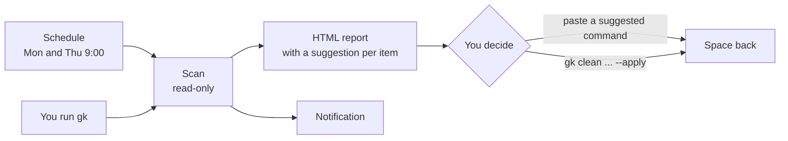
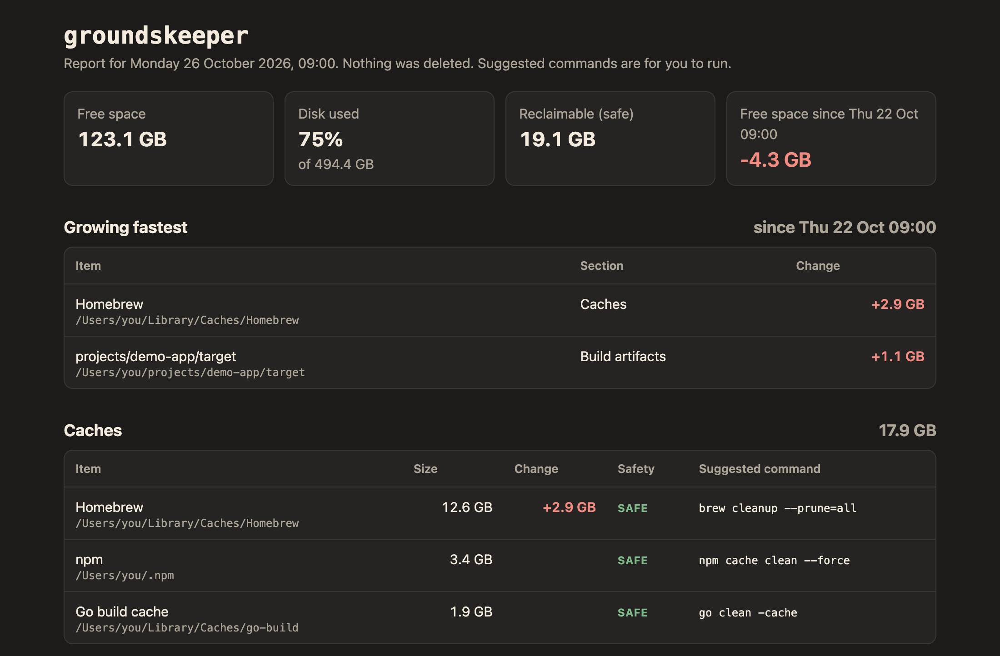
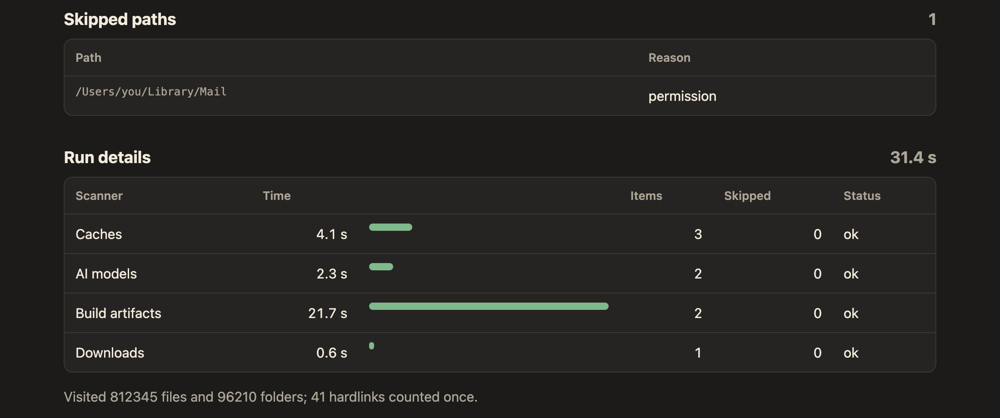
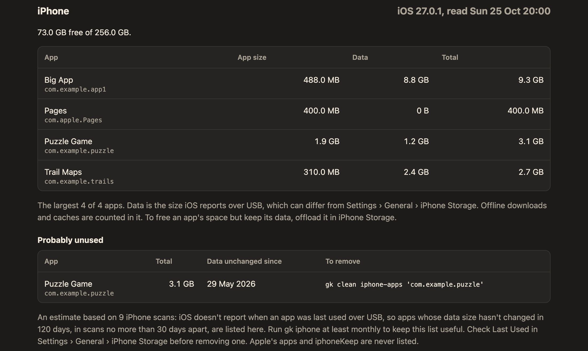
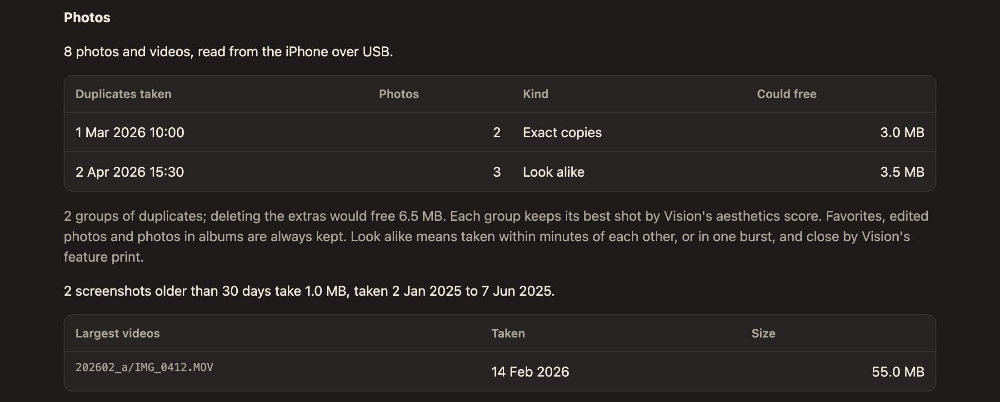
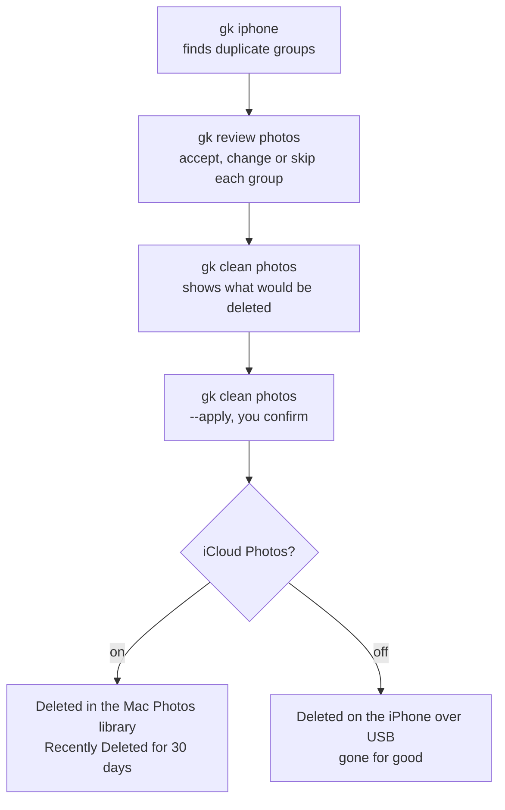

# Groundskeeper user guide

Groundskeeper (`groundskeeper`, or `gk` for short) finds disk space you can get back on your Mac, and on an iPhone plugged in over USB. Twice a week it scans and writes an HTML report. The report lists what's taking space and suggests a command for each item. It never deletes anything by itself: you decide what goes, and only `gk clean` commands remove anything.



This guide walks through using it, task by task. For every flag of a command, run `gk help <command>`.

## Install and first run

### What you need

- **macOS 26 or later.** The photo helper needs it.
- **The Xcode Command Line Tools,** for Swift 6.2. If you don't have them, run this and follow the prompt:
  ```sh
  xcode-select --install
  ```
- **Go,** from [go.dev/dl](https://go.dev/dl/) or Homebrew (`brew install go`). Any recent version works: the build downloads the exact version Groundskeeper needs.

There's no app or installer download. You build Groundskeeper from its source code, which takes a minute or two.

### Build and install

```sh
git clone https://github.com/shaynemeyer/groundskeeper.git
cd groundskeeper
make install
```

`make install` builds Groundskeeper and puts these in place:

| What | Where |
|---|---|
| The program, and `gk` as a short name for it | `~/bin/groundskeeper`, `~/bin/gk` |
| The photo helper, used for iPhone and Mac photos | `~/bin/photos-helper` |
| Tab completion for zsh | `~/.zsh/completions/_groundskeeper` |
| The schedule (a LaunchAgent) | `~/Library/LaunchAgents/com.lot86.groundskeeper.plist` |

It doesn't need `sudo` and asks for no password. To install a newer version later, run `git pull` and `make install` again in the same folder.

### Let your shell find gk

If `gk --version` says "command not found", `~/bin` isn't on your `PATH`. Add it, and turn on tab completion, by adding these lines to `~/.zshrc`:

```sh
export PATH="$HOME/bin:$PATH"
fpath=(~/.zsh/completions $fpath)
autoload -Uz compinit && compinit
```

Open a new terminal window, then check:

```sh
gk --version
```

### Give it Full Disk Access

macOS keeps some folders private (Safari, Mail, some browser data, and sometimes Downloads) unless an app has Full Disk Access. Without it, Groundskeeper still works but lists those folders under **Skipped paths** in the report instead of measuring them.

Open **System Settings > Privacy & Security > Full Disk Access** and add two things:

1. **Your terminal app** (Terminal, Ghostty, iTerm2 and so on), for scans you start yourself.
2. **`~/bin/groundskeeper`,** for the scheduled scans. Click **+**, press **Command-Shift-G**, type `~/bin/groundskeeper` and press Return.

Groundskeeper only measures file sizes. It never opens or reads the contents of private files such as cookies, passwords, history or messages. See [Privacy and your data](#privacy-and-your-data).

### Tell it where your code lives

Groundskeeper looks for old build output (`node_modules`, `target`, virtual environments and so on) inside your project folders. By default it looks in `~/projects`, `~/github`, `~/code` and `~/Developer`. If your code is somewhere else, create `~/.config/groundskeeper/config.json` with your folders:

```json
{
  "projectRoots": ["~/src", "~/work"]
}
```

Every other setting has a default; see [Configuration](#configuration).

### Check the setup

```sh
gk doctor
```

`doctor` checks everything above and says how to fix anything that's wrong. Each line starts with `ok`, `warn` or `fail`:

| Check | What it means |
|---|---|
| Installed binary | `~/bin/groundskeeper` exists. If not, run `make install`. |
| Photos helper | `~/bin/photos-helper` exists. Only photo scanning needs it. |
| Photos access | Whether your terminal app can read the Mac Photos library. Only matters if you scan photos on the Mac; see [Duplicate photos](#duplicate-photos). |
| Full Disk Access | Whether private folders can be measured. |
| Schedule | The LaunchAgent is installed and loaded, and when it runs next. |
| Last scheduled run | When the schedule last ran and whether anything failed. "None yet" is normal right after installing. |
| FileVault | Whether your disk is encrypted. Reports list folder and app names, so FileVault should be on. |
| Report folder | Reports are saved somewhere that doesn't sync to the cloud. |
| Log files | The logs can be read only by you. |

A `warn` is worth reading but doesn't stop anything. A `fail` means something won't work until you fix it.

### Your first scan

```sh
gk --open
```

This scans your Mac, which takes from a few seconds to a few minutes, then opens the report in your browser. In the terminal you'll see a short summary like this:

```
Free space   123.1 GB of 494.4 GB
Reclaimable  18.4 GB (safe items)
Report       ~/Reports/groundskeeper/2026-10-27.html

Largest items:
     12.6 GB  safe    Homebrew
      4.2 GB  review  Ollama: llama3:8b
      3.1 GB  safe    projects/demo-app/node_modules
```

Running `gk` with nothing after it does the same as `gk scan`. To see the summary without writing a report, run `gk scan --dry`.

## Reading the report



*A sample report. All the names, paths and sizes in this guide's screenshots are made up.*

Each report is saved as `~/Reports/groundskeeper/<date>.html`, and `latest.html` in the same folder is always the newest one. Old reports aren't deleted for you; remove them from that folder whenever you like.

### The top of the report

- **Free space:** how much of your disk is free right now.
- **Reclaimable (safe):** the total of the items tagged **safe**. This is space you can get back with no downside.
- **Since the last scan:** how free space changed, once there's an earlier scan to compare with.

### Sections

Items are grouped by what they are:

| Section | What it lists |
|---|---|
| Caches | Package manager caches (npm, Homebrew, pip, Go, Cargo and others) and the largest folders in `~/Library/Caches` |
| AI models | Ollama models, Hugging Face downloads, LM Studio and ComfyUI models |
| Build artifacts | `node_modules`, `target`, `.next`, virtual environments and similar folders in your projects |
| Toolchains | Rust toolchains, Node versions (Volta), Python versions (pyenv, uv) |
| Containers | Podman's virtual disk, and images and volumes inside it you could prune |
| Downloads | Files in `~/Downloads` older than 90 days |
| Browsers | Each browser's caches and offline data |
| Unused apps | Apps you haven't opened in 120 days, with their leftover data |

### Safety tags

Every item has a tag:

- **safe:** deleting it costs nothing; the tool that made it rebuilds it when needed. Caches, and build output in projects you haven't touched in 90 days, are safe.
- **review:** probably removable, but look first. A model you might still use, a project you're working on, an app you rarely open.
- **keep:** shown so you know where the space is, not as a suggestion. For example, a browser's cookies and site data.

### Suggested commands

Next to most items is a command that removes it, such as `npm cache clean --force` or `ollama rm 'llama3:8b'`. Groundskeeper never runs these. Copy one into your terminal if you want it. File names in the commands are quoted, so even a strangely named folder is passed as a single name and can't run anything else. See [Cleaning up the Mac](#cleaning-up-the-mac).

### Changes since the last scan

From the second scan on, the report has a **Change** column showing how much each item grew or shrank, and a **Growing fastest** list of the items that grew most. Use it to spot something filling your disk slowly.

### Skipped paths

Folders Groundskeeper couldn't measure, and why:

- **permission:** macOS didn't allow it. Give Full Disk Access as described in [Install and first run](#give-it-full-disk-access).
- **timeout:** measuring the folder took more than two minutes, so it was skipped. This can happen with folders holding millions of files.

### Run details



How long each part of the scan took, and how much it found. A part that was slow, timed out or failed is highlighted. You don't need this day to day, but it helps explain an incomplete report.

## Cleaning up the Mac

Groundskeeper suggests; you decide. There are three ways to act on the report. For everything Groundskeeper will and won't delete, run `gk help safety`.

### Run a suggested command yourself

For most items, copy the command next to it in the report and paste it into your terminal. For example, to clear npm's cache:

```sh
npm cache clean --force
```

Read the command before you run it. Items tagged **review** deserve a second look: `ollama rm` deletes a model you'd have to download again, and an `rm -rf` on a project's `node_modules` means running `npm install` before you work on it next. Commands that use `rm -rf` delete straight away; they don't use the Trash.

### Clear browser caches

Groundskeeper clears browser caches for you, because doing it by hand risks deleting the wrong folder. First see what it would do:

```sh
gk clean browsers
```

```
      5.0 MB  Brave · Cache                would move
             ~/Library/Caches/BraveSoftware/Brave-Browser/Default/Cache
      2.0 MB  Brave · Cache                would move
             ~/Library/Caches/BraveSoftware/Brave-Browser/Default/Code Cache
Dry run: nothing was changed. Add --apply to move 7.0 MB to the Trash.
```

Nothing changes until you add `--apply`. Then it moves the caches to the Trash straight away, without asking again:

```sh
gk clean browsers --apply
```

Things to know:

- **Quit the browser first.** A running browser is skipped, even in the dry run, because removing a cache it has open can corrupt it. The output says which browser to quit.
- **Pick browsers** with `--browser`, for example `gk clean browsers --browser chrome,firefox`. Without it, every installed browser is included.
- **Your browsing data is never touched:** cookies, logins, history, bookmarks and site data stay. The browser just downloads pages and images again as you visit them, so the first visits may be a little slower.
- **Offline data,** such as cached web apps and Chrome's on-device AI model, is left alone unless you add `--include-offline`. Sites that work offline will need a connection the next time you open them.
- If a folder can't be fully read (usually Safari's, without Full Disk Access), it's refused rather than partly moved.

### Move ticked items to the Trash

Caches, build artifacts, old downloads, and Hugging Face and LM Studio models can be moved to the Trash in one go. Tick them in `gk review mac`, then see what the review saved:

```sh
gk clean mac
```

```
3 items, 1.2 GB, ticked in the review of Tue 27 Oct 09:00, will be moved to the Trash.
Dry run: nothing was changed. Add --apply to move them to the Trash.
```

Then move them, answering `y` when asked:

```sh
gk clean mac --apply
```

Before each item moves, it's checked again. It must still be the kind of thing its section cleans (a cache, a build artifact in one of your project folders, a download, a model), inside your home folder, reached without a symlink, and still a file or a folder as it was. Anything else is refused, left where it is, and listed with the reason. Refused items, and any the Trash couldn't take, stay in the saved review.

Only rows that one move to the Trash fully cleans can be ticked. Ollama models, toolchains, containers, apps and `__pycache__` totals need their own tool, so run their suggested command instead. A Hugging Face model whose files live in the shared store needs `hf cache rm`.

### Get the space back

Moving something to the Trash doesn't free any space until you **empty the Trash** (Finder > Empty Trash). Until then you can undo it by dragging the folder out of the Trash back to where it was; the dry run's output shows the original location. The next report notes how much the clean commands moved to the Trash since the last one.

Every clean is written to the log; see it with `gk logs --cmd clean`.

## The schedule

`make install` sets up a scheduled scan every **Monday and Thursday at 9:00**. If your Mac is asleep then, the scan runs when it wakes. It only ever runs the read-only scan, never a clean command.

### The notification

When a scheduled scan finishes, you get a notification like:

> Rook's report is ready: 118.0 GB free, about 35.0 GB to tidy.

Rook is Groundskeeper's raccoon mascot. "To tidy" is the reclaimable total from the report. If something went wrong, the notification adds a line such as "2 scanners had problems; see the report." That means part of the scan failed or timed out, so the report is incomplete; [Run details](#run-details) and `gk logs --run last --level warn` say why. "3 new paths couldn't be read" means folders were skipped this time that weren't before, often because Full Disk Access was removed.

The notification is sent through macOS's Script Editor, so it shows Script Editor's icon. If you don't see any, check that **System Settings > Notifications > Script Editor** is allowed. Scans you start yourself don't notify unless you add `--notify`.

### Run it now

To run the scheduled scan immediately, exactly as the schedule runs it:

```sh
launchctl kickstart gui/$(id -u)/com.lot86.groundskeeper
```

`gk doctor` shows whether the schedule is loaded, when it runs next and when it last ran.

### Change the days or time

Edit `launchd/com.lot86.groundskeeper.plist` in the folder you cloned. Under `StartCalendarInterval`, each entry has a `Weekday` (1 is Monday, 0 or 7 is Sunday), an `Hour` and a `Minute`. Then run `make install` again to load the change. `gk help schedule` has the details.

### Turn it off

```sh
launchctl bootout gui/$(id -u)/com.lot86.groundskeeper
```

This pauses the schedule until you next log in, restart or run `make install`, because macOS loads it again at login. To turn it off for good, remove Groundskeeper with `make uninstall`; see [Remove Groundskeeper](#remove-groundskeeper).

## The iPhone

Plug your iPhone into the Mac with a cable, then run:

```sh
gk iphone
```

The first time, the iPhone asks whether to trust this Mac: unlock it and tap **Trust**. Groundskeeper reads the phone over the cable only; nothing goes over the network, and nothing on the phone is changed. It then reads your photos (see [Duplicate photos](#duplicate-photos)), scans the Mac as `gk scan` does, and writes the report with an **iPhone** section. Reading photos can take a few minutes.

If it can't reach the phone, it says what to do: connect the cable, unlock the phone and tap Trust, or unplug it and plug it in again.

### Where your photos are read from

The first `gk iphone` asks one question:

```
Is iCloud Photos turned on for this iPhone?
  > Yes — clean duplicates in this Mac's Photos library (changes sync to the phone)
    No  — clean duplicates on the phone directly over USB
    Not sure — show me how to check
```

To check, open **Settings > your name > iCloud > Photos** on the iPhone: if **Sync this iPhone** is on, iCloud Photos is on. The answer decides where duplicates are found and deleted:

- **Yes:** in the Photos library on this Mac. Deletes there sync to the phone, and deleted photos stay in **Recently Deleted** for 30 days. This only works if Photos on this Mac also uses iCloud Photos, with the same Apple Account.
- **No:** on the phone itself, over the cable. Keep the phone unlocked while `gk iphone` reads the photos. Deletes are **permanent**: they don't go to the phone's Recently Deleted.

The answer is saved as `photosSource` in your config. To answer again, run `gk setup photos`.

### Apps

The iPhone section lists free space and the 20 largest apps, with the size of each app and its data, and files that apps share with the Mac (such as books or videos you added through Finder). Sizes are what iOS reports over the cable, which can differ a little from **Settings > General > iPhone Storage**.



**Probably unused.** iOS doesn't tell a Mac when an app was last opened, so Groundskeeper guesses: an app whose data hasn't changed in size for 120 days is listed as probably unused. It needs a history to compare, so this list only appears after you've run `gk iphone` regularly (at least once a month) for 120 days. Apple's apps are never listed. To stop an app from ever being suggested, add its bundle ID to `iphoneKeep` in your config. Before removing one, check **Last Used** in iPhone Storage on the phone.

### Remove an app

Each app in the report shows its bundle ID, such as `com.example.game`, and apps listed as probably unused come with a ready-made command. First see what it would free:

```sh
gk clean iphone-apps com.example.game
```

Then remove it. You're asked before each app, and the phone shows no prompt of its own:

```sh
gk clean iphone-apps com.example.game --apply
```

**Removing an app deletes its data for good.** If you want to keep the data (game progress, documents) and only free the app's own size, **offload** it instead on the phone: **Settings > General > iPhone Storage**, tap the app, then **Offload App**.

Only apps from the last `gk iphone` can be removed, so run that first. Apple's apps and anything in `iphoneKeep` are always refused. Press Tab after `gk clean iphone-apps` to complete bundle IDs.

## Duplicate photos

`gk iphone` also looks through your photos and lists in the report:

- **Duplicates,** in groups. **Exact copies** are the same file twice. **Look alike** photos were taken within 10 minutes of each other (or in one burst) and look nearly the same, such as several shots of the same scene.
- **Old screenshots,** taken more than 30 days ago.
- **The largest videos.**



Groundskeeper only helps you delete duplicates. Delete screenshots and videos in the Photos app.

Getting rid of duplicates takes three commands, and nothing is deleted until the last one:



### Which photo is kept

In each group, the best shot is marked **Keep** and the others **Extra**. The best shot is the one Apple's image analysis scores as most pleasing. **Favorites, edited photos and photos in albums are always kept**, and every group keeps at least one photo. You can change any of this in the review.

### Review the duplicates

```sh
gk review photos
```

This steps through the groups one at a time. Nothing is deleted here; your choices are saved for `gk clean photos`.

| Key | What it does |
|---|---|
| arrow keys | Choose a photo in the group |
| k | Switch the chosen photo between Keep and Extra |
| space | Look at the photos |
| enter | Accept the group: its extras will be deleted |
| s | Skip the group: nothing in it will be deleted |
| p | Go back to the previous group |
| q | Save your choices so far and quit |
| ctrl+c | Quit without saving anything |

In the [Ghostty](https://ghostty.org) terminal the photos are shown right in the screen. In other terminals, press space to open them in Quick Look. The previews are copied into a private temporary folder that's removed when the review ends.

A new review replaces the previous one. Your choices are saved in `~/.local/state/groundskeeper/photo-review.json`.

### Delete the extras

First see what would be deleted:

```sh
gk clean photos
```

Then delete:

```sh
gk clean photos --apply
```

How it confirms depends on where your photos are:

- **iPhone (iCloud Photos off):** deleting is **permanent**. You're asked to type the number of photos to confirm.
- **Mac Photos library (iCloud Photos on):** you answer `y`, then macOS asks once more. Deleted photos stay in **Recently Deleted** for 30 days.

A photo that changed since `gk iphone` read it, or is no longer there, is left alone and listed with the reason. Photos that weren't deleted stay in the saved review, so you can try again.

**Try it on throwaway photos first.** Take a few near-identical shots of anything, run `gk iphone`, and in `gk review photos` accept only that group and skip the rest (s). Then run `gk clean photos --apply` and check the result on the phone. Unplug and plug the phone back in before `gk iphone` so it sees the new shots: the phone sends its photos as they were when it was connected.

### Photos on the Mac need permission

Reading the Mac Photos library needs Photos access for your terminal app; macOS asks the first time. Some terminals can't get it at all, notably the one built into VS Code, which macOS refuses without asking. Use Terminal, Ghostty or iTerm2 for anything involving the Mac library. `gk doctor` shows whether access is granted.

## Trends and troubleshooting

### See how your disk changes

```sh
gk history
```

Lists recent scans with free space and how much it changed since the scan before, then the items that grew most between the last two scans. Show more scans with `--runs`, for example `gk history --runs 20`. Scans are remembered for six months.

```sh
gk stats
```

Shows how the last scan went: how long each part took, what it found, what it skipped, and what clean commands did since. `gk stats --runs 5` compares the last five scans, which shows a part of the scan that keeps getting slower.

```sh
gk logs
```

Shows the newest entries from Groundskeeper's log. Useful filters:

```sh
gk logs --run last --level warn   # problems in the most recent run
gk logs --cmd clean               # everything clean commands did
gk logs -f                        # follow new entries as they come
```

### Common problems

**`gk: command not found`.** `~/bin` isn't on your `PATH`; see [Let your shell find gk](#let-your-shell-find-gk).

**A command or option from this guide doesn't exist.** Your installed copy is older than the guide. Check with `gk --version`, then update: `git pull` and `make install` in the folder you cloned.

**Folders listed under Skipped paths with "permission".** Give Full Disk Access to your terminal app, and to `~/bin/groundskeeper` for scheduled scans; see [Give it Full Disk Access](#give-it-full-disk-access). Run `gk doctor` to check.

**A folder skipped with "timeout".** It took more than two minutes to measure, usually because it holds millions of small files. If it's inside a project, you can tell Groundskeeper to stop looking there with `excludePaths`; see [Configuration](#configuration). The notification mentions it on every scan where it happens.

**"Photos access" warning, or the Mac Photos library can't be read.** Run Groundskeeper from Terminal, Ghostty or iTerm2, not from VS Code's built-in terminal. If you said no when macOS asked, allow your terminal app in **System Settings > Privacy & Security > Photos**.

**The iPhone isn't found.** Use a cable that carries data (some only charge), unlock the phone and tap Trust if it asks. If it still fails, unplug it and plug it in again.

**New photos don't show up.** The phone shares its photos as they were when you plugged it in. Unplug it, plug it in again, and run `gk iphone`.

**No notification after a scheduled scan.** Allow notifications for Script Editor in **System Settings > Notifications**. If `gk doctor` says the last scheduled run was more than a week ago, look in `~/Library/Logs/groundskeeper.launchd.log`.

**A warning that reports leave this Mac.** Your report folder is somewhere that syncs, such as iCloud Drive, Desktop or Documents. Set `outputDir` to a folder that doesn't sync; see [Configuration](#configuration).

## Privacy and your data

Groundskeeper is built to be safe to run with Full Disk Access:

- **Nothing leaves your Mac.** It makes no network requests at all: no telemetry, no update checks. The only connection it makes is to an iPhone over the cable.
- **It measures, it doesn't read.** It adds up file sizes. It never opens cookies, passwords, browsing history, messages, mail or other private files. The few files it does read are tool metadata, such as Ollama's model list and an app's `Info.plist`.
- **No secrets in its output.** Reports, logs and saved scans hold folder paths, sizes, dates and IDs, never file contents or passwords.

Run `gk help privacy` for the short version.

### What it stores, and where

| What | Where |
|---|---|
| Reports | `~/Reports/groundskeeper/` (or your `outputDir`) |
| Saved scans, your photo and Mac reviews, and the iPhone's history | `~/.local/state/groundskeeper/` |
| Log | `~/Library/Logs/groundskeeper.log`, started afresh at 5 MB with the last three kept, plus `groundskeeper.launchd.log` from the schedule |
| Settings | `~/.config/groundskeeper/config.json`, if you create it |

All of these can be read only by your user. The reports list folder, project and app names, so treat them as private. Groundskeeper doesn't encrypt them itself; **FileVault** encrypts the whole disk, and `gk doctor` warns if it's off. Time Machine backs them up like any other files, so turn on backup encryption in Time Machine's settings too.

Saved scans older than six months are deleted automatically. That's the only thing Groundskeeper ever deletes on its own.

### Remove Groundskeeper

In the folder you cloned:

```sh
make uninstall
```

This removes the program, `gk`, the photo helper, tab completion and the schedule. Your reports, saved scans, logs and settings stay. To remove those as well:

```sh
rm -rf ~/Reports/groundskeeper ~/.local/state/groundskeeper ~/.config/groundskeeper
rm -f ~/Library/Logs/groundskeeper.log* ~/Library/Logs/groundskeeper.launchd.log
```

If you set `outputDir`, delete that folder instead of `~/Reports/groundskeeper`. Finally, remove Groundskeeper and your terminal from **Full Disk Access** in System Settings if you no longer need them there, and delete the cloned folder.

## Configuration

Settings live in `~/.config/groundskeeper/config.json`. The file is optional: anything you leave out uses its default. Paths can start with `~`. A full example with every default:

```json
{
  "projectRoots": ["~/projects", "~/github", "~/code", "~/Developer"],
  "staleDays": 90,
  "minSizeMB": 100,
  "outputDir": "~/Reports/groundskeeper",
  "extraPaths": [],
  "excludePaths": [],
  "appUnusedDays": 120,
  "appExclude": [],
  "iphoneUnusedDays": 120,
  "iphoneKeep": [],
  "photosSource": "",
  "photoWindowMinutes": 10,
  "screenshotDays": 30,
  "logLevel": "info"
}
```

| Key | Default | What it does |
|---|---|---|
| `projectRoots` | `~/projects`, `~/github`, `~/code`, `~/Developer` | Folders searched for build artifacts and project-local AI models. |
| `staleDays` | `90` | A project untouched this long has its build artifacts marked safe. Also how old a download must be to be listed. |
| `minSizeMB` | `100` | Items smaller than this are left out of the report. |
| `outputDir` | `~/Reports/groundskeeper` | Where reports are saved. Keep it out of synced folders. |
| `extraPaths` | none | Reserved for extra folders to measure. Not used yet. |
| `excludePaths` | none | Folders inside your project roots that the build-artifact search skips entirely. |
| `appUnusedDays` | `120` | An app not opened for this long is listed as unused. |
| `appExclude` | none | Bundle IDs of Mac apps never to list as unused, such as an installer or VPN you rarely open. |
| `iphoneUnusedDays` | `120` | An iPhone app whose data hasn't changed for this long is listed as probably unused. |
| `iphoneKeep` | none | Bundle IDs of iPhone apps never to suggest removing. |
| `photosSource` | asked on first `gk iphone` | `device` (read and delete photos on the phone) or `mac-library` (in the Mac Photos library). Set it with `gk setup photos`. |
| `photoWindowMinutes` | `10` | How close in time two photos must be to count as look-alikes. |
| `screenshotDays` | `30` | Screenshots older than this are listed as old. |
| `logLevel` | `info` | How much goes in the log: `debug`, `info`, `warn` or `error`. |

For example, to report smaller items and keep a VPN app off the unused list:

```json
{
  "minSizeMB": 50,
  "appExclude": ["com.example.vpn-client"]
}
```
